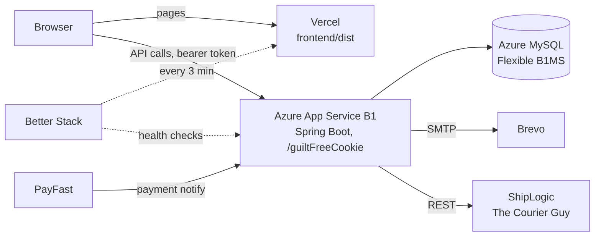

# Hosting plan

GuiltFreeCookie goes live on **Vercel** (storefront and admin) and **Azure for Students** (API and MySQL). That costs **$0 in cash**. The API runs on about $13 a month of student credit, so the $100 credit lasts around 7 months.

Read this together with [DEPLOYMENT.md](DEPLOYMENT.md), which lists every environment variable and the go-live checks.

## 1. What runs where



| Local today | Hosted |
|---|---|
| `http://localhost:5173` | `https://<project>.vercel.app` |
| `http://localhost:8080/guiltFreeCookie` | `https://<app>.azurewebsites.net/guiltFreeCookie` |
| Cloudflare tunnel | Not needed. PayFast calls the Azure URL directly. Keep the tunnel for local development |
| Mailpit `:8025` | Brevo |

## 2. Costs

Approximate USD prices. Check the [Azure pricing calculator](https://azure.microsoft.com/pricing/calculator/) for the region you choose; South Africa North costs a little more than EU regions.

| Piece | Service | Cost |
|---|---|---|
| Frontend | Vercel Hobby | $0. Hobby is for non-commercial use only, which covers a uni project |
| API | Azure App Service, Basic B1, Linux, Java | about $13/month, from student credit |
| Database | Azure Database for MySQL Flexible Server, Burstable B1MS | $0 for 12 months (750 hours/month and 32 GB are free services). About $12–15/month after that |
| Cookie photos | App Service's `/home` folder (persists across restarts) | $0 |
| Payments | PayFast sandbox | $0 |
| Email | Brevo free (300/day) | $0 |
| Delivery | ShipLogic (The Courier Guy) sandbox | $0 while testing, per shipment once live |
| Uptime alerts | Better Stack free (10 monitors at 3 minutes, 10 heartbeats, status page) | $0 |
| Error tracking | Sentry free Developer plan | $0 |
| Domain | `*.vercel.app` (or a free domain from the GitHub Student Developer Pack) | $0 |
| **Total** | | **$0 cash, about $13/month of credit** |

Azure for Students needs no credit card. When the credit runs out, Azure switches services off; it never bills you. The ordinary Azure free account is different: its $200 credit expires after 30 days.

## 3. Decisions and why

**The browser calls the API on Azure directly, not through a Vercel rewrite.** Two things break behind a Vercel proxy:

- [PayFastVerifier.java](../src/main/java/za/ac/cput/guiltfreecookie/service/payment/PayFastVerifier.java) checks that payment notifications come from PayFast's IP addresses. Through Vercel, they'd come from Vercel's addresses and be rejected, so orders would never turn **Paid**.
- The app only trusts forwarded client IPs from private networks ([application.properties](../src/main/resources/application.properties), `server.forward-headers-strategy`). Through Vercel, every visitor would share Vercel's IPs, and the rate limiter would treat them as one user.

Auth uses bearer tokens, not cookies, so cross-origin calls need nothing beyond `CORS_ALLOWED_ORIGINS`. When `VITE_API_BASE_URL` is set, the build adds the API's origin to the page's Content-Security-Policy (`connect-src` and `img-src`, in [vite.config.js](../frontend/vite.config.js)).

**App Service B1, not the free F1 tier.** F1 allows 60 CPU minutes a day and has no Always On, so the app goes to sleep. While it sleeps, the scheduled jobs stop: reservation expiry, email flows and the daily cron. Spring Boot also starts slowly on F1. A B1s VM is free for 12 months, but you would have to set up HTTPS, restarts and updates yourself, all on 1 GB of RAM.

**No catch-all rewrite on Vercel.** Vercel serves `dist/404.html` for unknown paths. That page starts the app, so private pages (`/order/…`, `/admindashboard`) still load, while search engines see a 404.

## 4. Setup, step by step

### 4.1 Azure MySQL

1. Create an **Azure Database for MySQL Flexible Server**: Burstable **B1MS**, MySQL 8, 32 GB storage, in the same region as the App Service.
2. Under Networking, choose public access and tick **Allow public access from any Azure service**. Add your own IP if you want to connect from MySQL Workbench.
3. Create a database `guiltfreecookie` and a user with rights on that schema only.
4. Set the server parameter `time_zone` to `+02:00`.

### 4.2 Azure App Service

1. Create a **Web App**: Publish *Code*, Runtime stack *Java 25 (Java SE)*, OS *Linux*, plan **Basic B1**, same region as the database.
   - If Java 25 isn't in the list, check `az webapp list-runtimes --os linux`. If it's still missing, deploy the API as a container instead (needs a Dockerfile).
2. Configuration → General settings: turn **Always On** on.
3. Configuration → Health check: path `/guiltFreeCookie/actuator/health/readiness` (see section 7).
4. Configuration → Application settings: add the variables below, plus the remaining ones from [DEPLOYMENT.md](DEPLOYMENT.md) section 2.

```
SPRING_PROFILES_ACTIVE=prod
PORT=80
DB_URL=jdbc:mysql://<server>.mysql.database.azure.com:3306/guiltfreecookie?sslMode=REQUIRED&serverTimezone=Africa/Johannesburg
DB_USERNAME=<user>
DB_PASSWORD=<password>
JWT_SECRET=<openssl rand -base64 32>
CORS_ALLOWED_ORIGINS=https://<project>.vercel.app
FRONTEND_BASE_URL=https://<project>.vercel.app
PUBLIC_BASE_URL=https://<app>.azurewebsites.net/guiltFreeCookie
UPLOAD_DIR=/home/uploads
PAYFAST_SANDBOX=true
PAYFAST_MERCHANT_ID=10000100
PAYFAST_MERCHANT_KEY=<sandbox key>
PAYFAST_PASSPHRASE=<sandbox passphrase>
MAIL_HOST=smtp-relay.brevo.com
MAIL_PORT=587
MAIL_USERNAME=<Brevo SMTP login>
MAIL_PASSWORD=<Brevo SMTP key>
MAIL_SMTP_AUTH=true
MAIL_STARTTLS=true
MAIL_FROM=GuiltFreeCookie <hello@<your-domain>>
ADMIN_BOOTSTRAP_EMAIL=<first admin email>
ADMIN_BOOTSTRAP_PASSWORD=<12+ characters>
JPA_DDL_AUTO=update
```

- `PORT=80` is there because App Service on Linux sends traffic to port 80, and the app reads `PORT`.
- `JPA_DDL_AUTO=update` is for the first start only: it creates the tables. Remove it afterwards, along with the two `ADMIN_BOOTSTRAP_*` variables.
- Brevo setup (domain records, SMTP key, tracking settings) is in [SERVICES-PLAN.md](SERVICES-PLAN.md) section 1.

### 4.3 Vercel

1. Import the GitHub repo into Vercel and set **Root Directory** to `frontend`.
2. Add these environment variables (Production):

```
VITE_SITE_URL=https://<project>.vercel.app
VITE_API_BASE_URL=https://<app>.azurewebsites.net/guiltFreeCookie
PRERENDER_API_URL=https://<app>.azurewebsites.net/guiltFreeCookie
```

3. Add [`frontend/vercel.json`](#6-vercel-config-with-security-headers) from section 6.
4. Deploy the API first. The frontend build reads the catalogue from `PRERENDER_API_URL` to prerender product pages, so the API has to be running when Vercel builds.

### 4.4 GitHub secret

App Service → Overview → **Download publish profile**. In GitHub, go to repo → Settings → Secrets and variables → Actions, and add the file's contents as `AZURE_WEBAPP_PUBLISH_PROFILE`. If the download is greyed out, turn on Configuration → General settings → **SCM Basic Auth Publishing Credentials**.

## 5. GitHub Actions: build and deploy the API

`.github/workflows/deploy-api.yml`. It runs the tests, builds the jar and deploys it whenever backend code reaches `main`. It can also be started by hand from the Actions tab.

```yaml
name: Deploy API to Azure

on:
  push:
    branches: [main]
    paths:
      - "src/**"
      - "pom.xml"
      - ".github/workflows/deploy-api.yml"
  workflow_dispatch:

concurrency:
  group: deploy-api
  cancel-in-progress: false

env:
  AZURE_WEBAPP_NAME: <app>

jobs:
  build-and-deploy:
    runs-on: ubuntu-latest
    environment: production
    steps:
      - uses: actions/checkout@v4

      - uses: actions/setup-java@v4
        with:
          distribution: temurin
          java-version: "25"
          cache: maven

      - name: Test and package
        run: ./mvnw -B verify

      - name: Pick the jar
        run: cp target/guiltFreeCookie-*.jar app.jar

      - uses: azure/webapps-deploy@v3
        with:
          app-name: ${{ env.AZURE_WEBAPP_NAME }}
          publish-profile: ${{ secrets.AZURE_WEBAPP_PUBLISH_PROFILE }}
          package: app.jar
```

- If `./mvnw` isn't executable in git, run `git update-index --chmod=+x mvnw` once.
- Vercel deploys the frontend itself on every push, so the workflow only handles the API.

## 6. Vercel config with security headers

`frontend/vercel.json`. The headers are the ones the [README](../README.md) asks the host to set. The Content-Security-Policy already comes from a `<meta>` tag in every page.

```json
{
  "$schema": "https://openapi.vercel.sh/vercel.json",
  "framework": null,
  "installCommand": "npm ci",
  "buildCommand": "npm run build",
  "outputDirectory": "dist",
  "headers": [
    {
      "source": "/(.*)",
      "headers": [
        { "key": "Strict-Transport-Security", "value": "max-age=31536000; includeSubDomains" },
        { "key": "X-Frame-Options", "value": "DENY" },
        { "key": "X-Content-Type-Options", "value": "nosniff" },
        { "key": "Referrer-Policy", "value": "strict-origin-when-cross-origin" },
        { "key": "Permissions-Policy", "value": "camera=(), microphone=(), geolocation=(), payment=()" }
      ]
    }
  ]
}
```

`"framework": null` stops Vercel from applying a preset that could add its own rewrites. There are deliberately no `rewrites` (see section 3).

## 7. Health checks: app, and mail plus delivery

Three endpoints, each with one job:

| Endpoint | Includes | Watched by | If it fails |
|---|---|---|---|
| `/actuator/health/readiness` | app state, database | Azure Health check | Azure restarts the instance |
| `/actuator/health` | everything (app, database, mail, delivery) | Better Stack | You get an alert |
| `/actuator/health/dependencies` | mail, delivery API | Better Stack | You get an alert saying which provider is down |

This way a Brevo or courier outage alerts you but never makes Azure restart the shop. That's the reason the current config switches the mail check off.

### 7.1 Properties

In `application.properties`, replace the health block with:

```properties
management.endpoints.web.exposure.include=health
management.endpoint.health.show-details=never
management.endpoint.health.probes.enabled=true
management.health.mail.enabled=true
management.endpoint.health.group.readiness.include=readinessState,db
management.endpoint.health.group.dependencies.include=mail,delivery
management.endpoint.health.validate-group-membership=false
```

The last line matters until the delivery API is wired in. Without it, Spring Boot refuses to start because the `dependencies` group names a `delivery` check that doesn't exist yet.

### 7.2 Security

In [SecurityConfig.java](../src/main/java/za/ac/cput/guiltfreecookie/config/SecurityConfig.java), widen the public health rule so the group paths are reachable:

```java
.requestMatchers(HttpMethod.GET, "/actuator/health", "/actuator/health/**").permitAll()
```

With `show-details=never`, every endpoint answers only `{"status":"UP"}` or `{"status":"DOWN"}` (HTTP 503). It never reveals hostnames or errors.

### 7.3 Delivery API indicator

Spring Boot already ships the mail check: it opens an SMTP connection to `MAIL_HOST`. The delivery check is one small class. It's registered as `delivery` (the bean name minus `HealthIndicator`) and only switches on once `DELIVERY_API_BASE_URL` is set.

`src/main/java/za/ac/cput/guiltfreecookie/config/DeliveryHealthIndicator.java`:

```java
package za.ac.cput.guiltfreecookie.config;

import org.springframework.beans.factory.annotation.Value;
import org.springframework.boot.autoconfigure.condition.ConditionalOnExpression;
import org.springframework.boot.health.contributor.AbstractHealthIndicator;
import org.springframework.boot.health.contributor.Health;
import org.springframework.http.client.SimpleClientHttpRequestFactory;
import org.springframework.stereotype.Component;
import org.springframework.web.client.RestClient;

@Component("deliveryHealthIndicator")
@ConditionalOnExpression("!'${app.delivery.base-url:}'.isBlank()")
public class DeliveryHealthIndicator extends AbstractHealthIndicator {

    private final RestClient client;

    public DeliveryHealthIndicator(@Value("${app.delivery.base-url}") String baseUrl,
                                   @Value("${app.delivery.api-key:}") String apiKey) {
        var timeouts = new SimpleClientHttpRequestFactory();
        timeouts.setConnectTimeout(3000);
        timeouts.setReadTimeout(3000);
        this.client = RestClient.builder()
                .baseUrl(baseUrl)
                .requestFactory(timeouts)
                .defaultHeader("Authorization", "Bearer " + apiKey)
                .build();
    }

    @Override
    protected void doHealthCheck(Health.Builder builder) {
        client.get().uri("/").retrieve().toBodilessEntity();
        builder.up();
    }
}
```

```properties
app.delivery.base-url=${DELIVERY_API_BASE_URL:}
app.delivery.api-key=${DELIVERY_API_KEY:}
```

Once you've chosen a provider, swap `"/"` for its cheapest authenticated GET, e.g. a rates or account endpoint, and use whatever auth header it documents. Until `DELIVERY_API_BASE_URL` is set, there's no `delivery` check, and the `dependencies` group reports on mail alone.

### 7.4 Better Stack

Create three uptime monitors at a 3-minute interval. Heartbeats for the scheduled jobs, Sentry, and the status page are in [SERVICES-PLAN.md](SERVICES-PLAN.md) section 2.

| Monitor | URL | Alert when |
|---|---|---|
| Storefront | `https://<project>.vercel.app/` | not 200 |
| API | `https://<app>.azurewebsites.net/guiltFreeCookie/actuator/health` | not 200 |
| Mail and delivery | `https://<app>.azurewebsites.net/guiltFreeCookie/actuator/health/dependencies` | not 200 |

## 8. Go-live checklist

- [ ] MySQL server and database created, Azure-services access on
- [ ] App Service created on B1 with Always On, health check path set, app settings added
- [ ] `AZURE_WEBAPP_PUBLISH_PROFILE` secret added, workflow green, `/actuator/health` returns `UP`
- [ ] First start done: remove `JPA_DDL_AUTO` and the `ADMIN_BOOTSTRAP_*` settings, then restart
- [ ] Vercel project live with the three `VITE_*`/`PRERENDER_*` variables and `vercel.json`
- [ ] Headers checked on [securityheaders.com](https://securityheaders.com)
- [ ] Sandbox order paid end to end: it turns **Paid**, the confirmation email arrives, stock goes down. If it stays unpaid, check the App Service log for `isn't a PayFast address`. That would mean Azure's front end isn't on Tomcat's trusted-proxy list, and `server.tomcat.remoteip.internal-proxies` needs to include it
- [ ] Uploaded cookie photo still shows after an App Service restart
- [ ] Three Better Stack monitors green. Test one by setting a wrong `MAIL_PASSWORD` and confirming the alert arrives
- [ ] Azure cost alert set at $15/month (Cost Management → Budgets)
